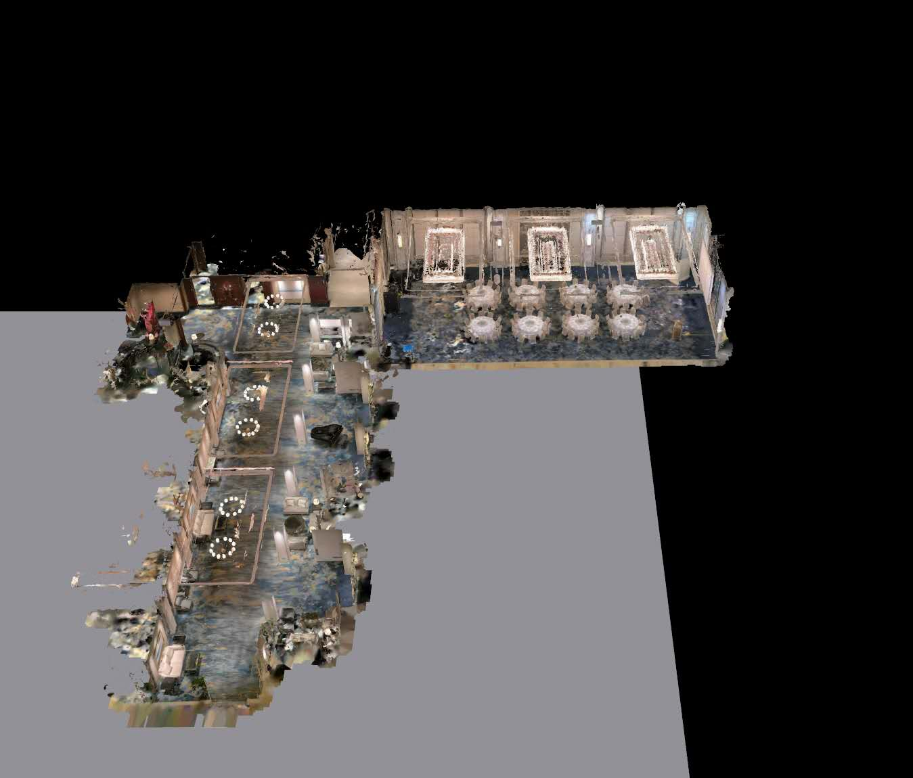
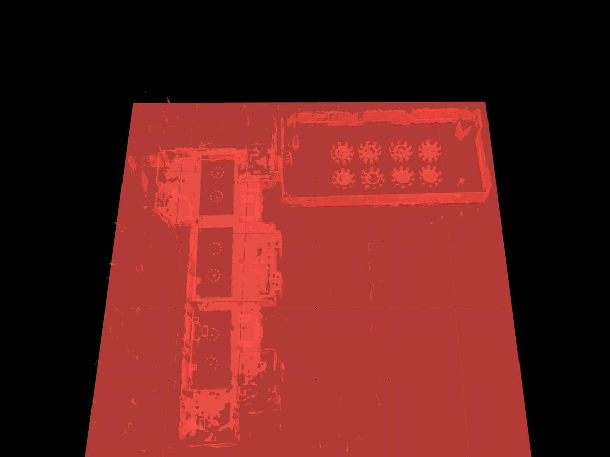
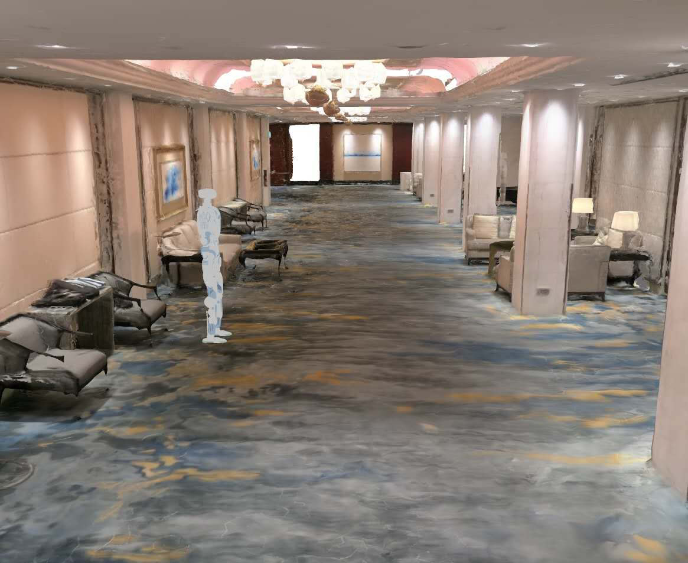
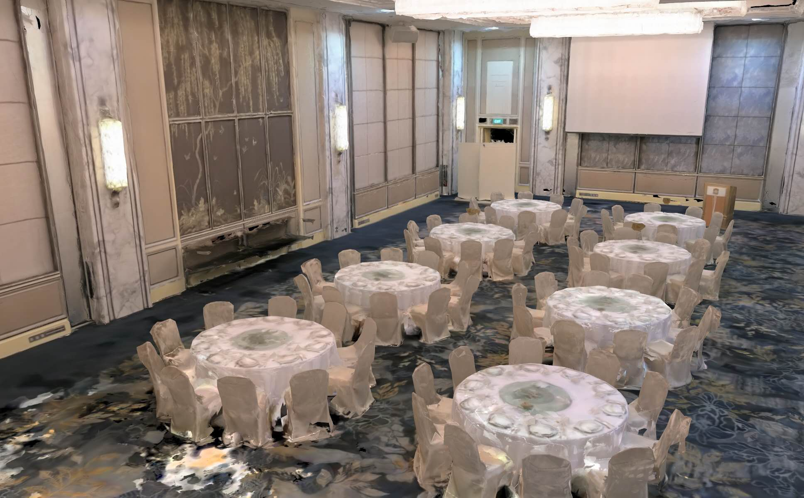

# 3DGS_Scenes_Private

**English** | [中文](README.zh-CN.md)

Real indoor spaces captured with 3D Gaussian Splatting (3DGS) and turned into ready-to-load **MuJoCo** simulation scenes for legged-robot navigation and perception.

Each scene has three aligned layers:

| Layer | What it is | Used for |
|---|---|---|
| Visual mesh | Textured mesh baked from the Gaussians (8192² atlas, split into chunks for frustum culling) | MuJoCo viewer, debugging |
| SDF collision | Tiled signed-distance fields (`sdfvoxel` plugin, 2–4 cm voxels) with a flat, measured floor | Physics, contacts, foot placement |
| 3DGS camera layer | Gaussian point cloud (`.ply`, Z-up, aligned to the scene frame) | Photo-realistic robot camera images |

## Scenes

| Scene | Space | Size | Collision | Assets (without `.ply`) | Gaussians `.ply` |
|---|---|---|---|---|---|
| `mj_3dgs_5f` | Office floor: corridors, open-plan desks, meeting rooms | ~76 × 42 m | 60 SDF tiles | 333 MB | 1.9 GB |
| `mj_3dgs_hall` | Conference hall: L-shaped corridor + banquet hall, 728 m² indoor | ~47 × 42 m | 36 SDF tiles | 313 MB | 0.35 GB |
| `mj_3dgs_penthouse` | Penthouse apartment: living area, double-height room, glazed facade | ~24 × 33 m indoor | 15 SDF tiles | 402 MB | 1.4 GB |

### Conference hall

<p align="center">
  
  
  
  
</p>

## What went into the scenes

- **Floor drift removal.** Scans bend by up to ~0.27 m over a floor. A measured drift field is removed from the mesh, the SDF and the `.ply` together, so all three layers stay aligned (camera vs. collision: ~13 mm).
- **Separate floor patch.** The scanned floor is replaced by a near-flat textured patch; measured visual-to-plane error 0.14 mm in the hall.
- **SDF collision instead of convex hulls.** Convex hulls fill the gaps between furniture, so the robot gets blocked by obstacles that are not there; tiled SDFs follow the scanned geometry and keep the gaps between tables and chairs and the shape of low furniture.
- **Glass handled explicitly.** 3DGS does not reconstruct glass, so the building envelope is closed where needed.
- **Mesh chunking.** Splitting the visual mesh into chunks gives MuJoCo per-chunk frustum culling: about 12× faster rendering at the same quality.
- **Validated.** Every scene is checked for floor flatness, drop tests (no penetration, no phantom contacts) and SDF residuals. Details are in each scene's `SOURCE.md`.

## Quick start

Requirements: Python 3, MuJoCo 3.2.3, and the `sdfvoxel` SDF plugin (`libsdfvoxel.so`, not included in this repo).

```bash
git clone https://github.com/eiche-1206/3DGS_Scenes_Private.git
cd 3DGS_Scenes_Private
pip install mujoco==3.2.3

# Open a scene in the MuJoCo viewer
python tools/view_scene.py mj_3dgs_hall --plugin /path/to/libsdfvoxel.so
```

`view_scene.py` makes the SDF tile paths absolute (the plugin requires this), loads the plugin and starts the viewer. The scenes contain no robot; add your own robot MJCF with `<include>` or by merging it into `scene.xml`.

### Gaussian point clouds (`.ply`)

The `.ply` files are stored with **Git LFS**. A normal clone only gets small pointer files; MuJoCo scenes work without them.

```bash
git lfs install
git lfs pull                                   # all scenes
git lfs pull --include="mj_3dgs_hall/**"      # one scene only
```

The `.ply` files are standard 3DGS format and open in any 3DGS viewer (e.g. SuperSplat). The hall scan uses SH degree 0; the other two use SH degree 3.

## Repository layout

```
<scene>/
  scene.xml      MJCF entry point
  meta.yaml      scene metadata (size, map settings, 3DGS layer settings)
  SOURCE.md      build log: source scan, decisions, measurements, known issues
  assets/
    *.obj *.mtl *.png    visual mesh and texture atlas
    sdf/*.npz            SDF collision tiles
    *_gs_*.ply           Gaussian point cloud (Git LFS)
tools/view_scene.py      open a scene in the MuJoCo viewer
docs/media/              scene images and demo videos
```
