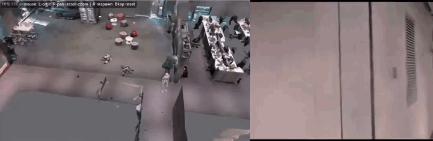
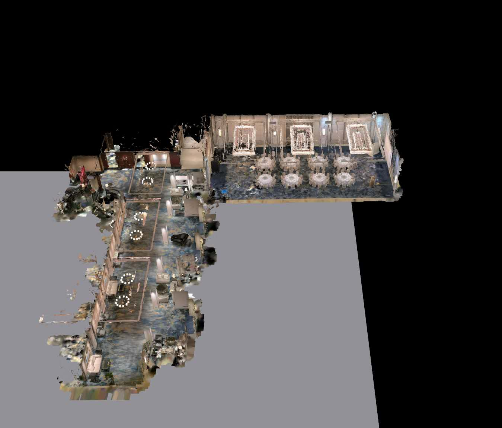
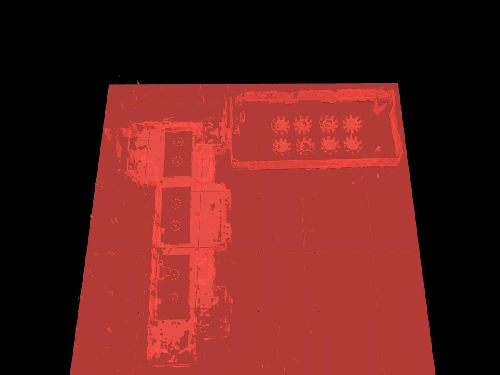
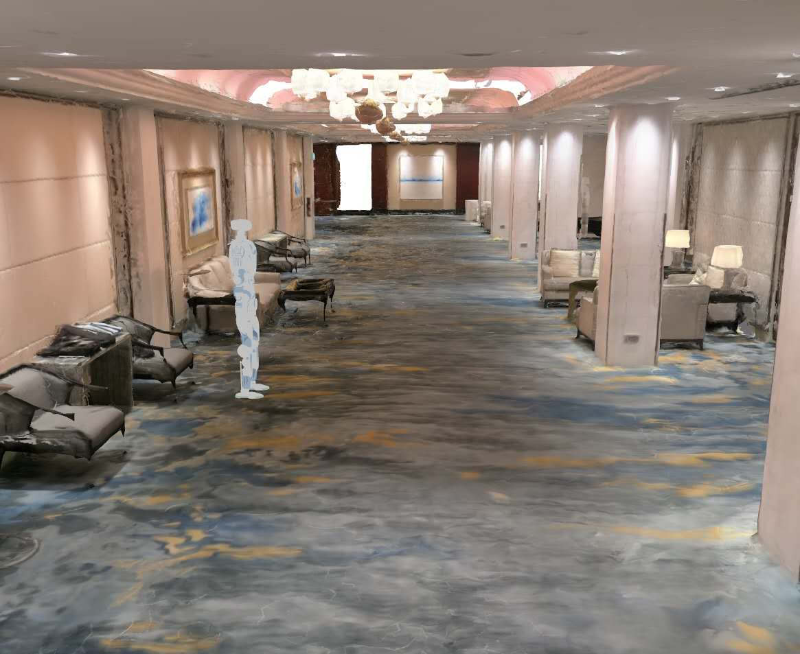
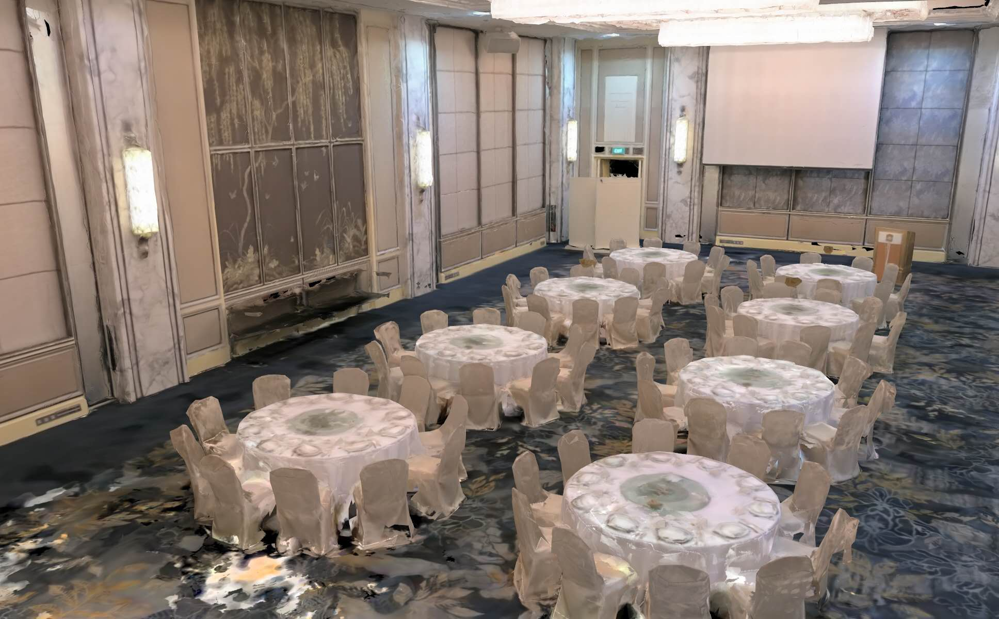
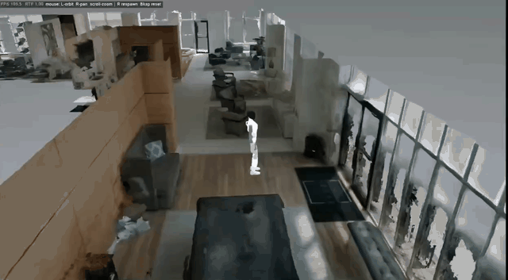

# 3DGS_Scenes

[English](README.md) | **中文**

用 3D 高斯泼溅（3DGS）扫描的真实室内空间，转换成可以直接加载的 **MuJoCo** 仿真场景，用于足式机器人的导航与感知仿真。

### 3DGS场景

<p align="center">
  <a href="docs/media/office5f_navigation_demo.mp4"></a>
</p>
<p align="center"><sub><b>办公室楼层</b>：导航演示（2 倍速，点击查看完整 90 秒视频）</sub></p>

每个场景包含三层，彼此对齐：

| 层 | 内容 | 用途 |
|---|---|---|
| 视觉网格 | 由高斯烘焙出的带贴图网格（8192² 图集，按区域分块以便视锥剔除） | MuJoCo 可视化、调试 |
| SDF 碰撞 | 分块的有符号距离场（`sdfvoxel` 插件，2–4 cm 体素），地面经过实测找平 | 物理、接触、落脚 |
| 3DGS 相机层 | 高斯点云（`.ply`，Z 轴朝上，与场景坐标系对齐） | 机器人相机的真实感图像 |

## 场景

| 场景 | 空间 | 尺寸 | 碰撞 | 资产（不含 `.ply`） | 高斯 `.ply` |
|---|---|---|---|---|---|
| `mj_3dgs_5f` | 办公楼层：走廊、开放工位、会议室 | 约 76 × 42 m | 60 块 SDF | 333 MB | 1.9 GB |
| `mj_3dgs_hall` | 会议厅：L 形走廊 + 宴会厅，室内 728 m² | 约 47 × 42 m | 36 块 SDF | 313 MB | 0.35 GB |
| `mj_3dgs_penthouse` | 顶层公寓：客厅、挑高空间、玻璃幕墙 | 室内约 24 × 33 m | 15 块 SDF | 402 MB | 1.4 GB |

### 会议厅

<p align="center">
  
  
  
  
</p>

### 顶层公寓

<p align="center">
  <a href="docs/media/penthouse_humanoid_demo.mp4"></a>
</p>
<p align="center"><sub><b>顶层公寓</b>：人形机器人演示（点击查看视频）</sub></p>

## 做了哪些处理

- **去除地面漂移。** 扫描的地面整体会弯曲，最多约 0.27 m。实测出漂移场后，对网格、SDF 和 `.ply` 一起校正，三层保持对齐（相机层与碰撞层约差 13 mm）。
- **独立地板件。** 用近乎平整的带贴图地板替换扫描地面；会议厅视觉地面与平面的误差实测 0.14 mm。
- **用 SDF 代替凸包碰撞。** 凸包会把家具之间的空隙一起填满，机器人容易被不存在的障碍挡住；分块 SDF 直接贴合扫描几何，保留桌椅间的缝隙和低矮家具的形状。
- **玻璃单独处理。** 3DGS 重建不出玻璃，需要的地方手动封闭建筑外壳。
- **网格分块。** 视觉网格分块后 MuJoCo 可以逐块视锥剔除，画质不变，渲染约快 12 倍。
- **验证。** 每个场景都检查了地面平整度、掉落测试（无穿透、无幽灵接触）和 SDF 残差，详见各场景的 `SOURCE.md`。

## 使用说明

环境：Python 3、MuJoCo 3.2.3，以及 `sdfvoxel` SDF 插件（`libsdfvoxel.so`，本仓库不包含）。

```bash
git clone https://github.com/eiche-1206/3DGS_Scenes.git
cd 3DGS_Scenes
pip install mujoco==3.2.3

# 在 MuJoCo viewer 中打开场景
python tools/view_scene.py mj_3dgs_hall --plugin /path/to/libsdfvoxel.so
```

`view_scene.py` 会把 SDF 瓦片路径改为绝对路径（插件要求），加载插件并打开 viewer。场景里没有机器人，可以用 `<include>` 或直接合并到 `scene.xml` 加入自己的机器人 MJCF。

### 高斯点云（`.ply`）

`.ply` 文件用 **Git LFS** 存放。普通 clone 只得到很小的指针文件；没有它们 MuJoCo 场景也能正常使用。

```bash
git lfs install
git lfs pull                                   # 全部场景
git lfs pull --include="mj_3dgs_hall/**"      # 只取一个场景
```

`.ply` 为标准 3DGS 格式，可用任意 3DGS 查看器打开（例如 SuperSplat）。会议厅扫描为 SH 0 阶，另外两个为 SH 3 阶。

## 仓库结构

```
<scene>/
  scene.xml      MJCF 入口
  meta.yaml      场景元数据（尺寸、地图参数、3DGS 层设置）
  SOURCE.md      构建记录：扫描来源、决策、实测数据、已知问题
  assets/
    *.obj *.mtl *.png    视觉网格与贴图图集
    sdf/*.npz            SDF 碰撞瓦片
    *_gs_*.ply           高斯点云（Git LFS）
tools/view_scene.py      在 MuJoCo viewer 中打开场景
docs/media/              场景截图和演示视频
```
